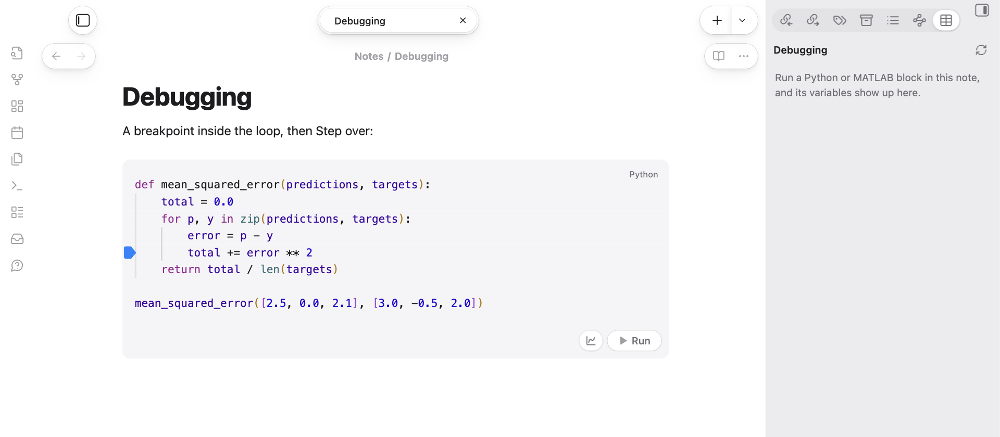
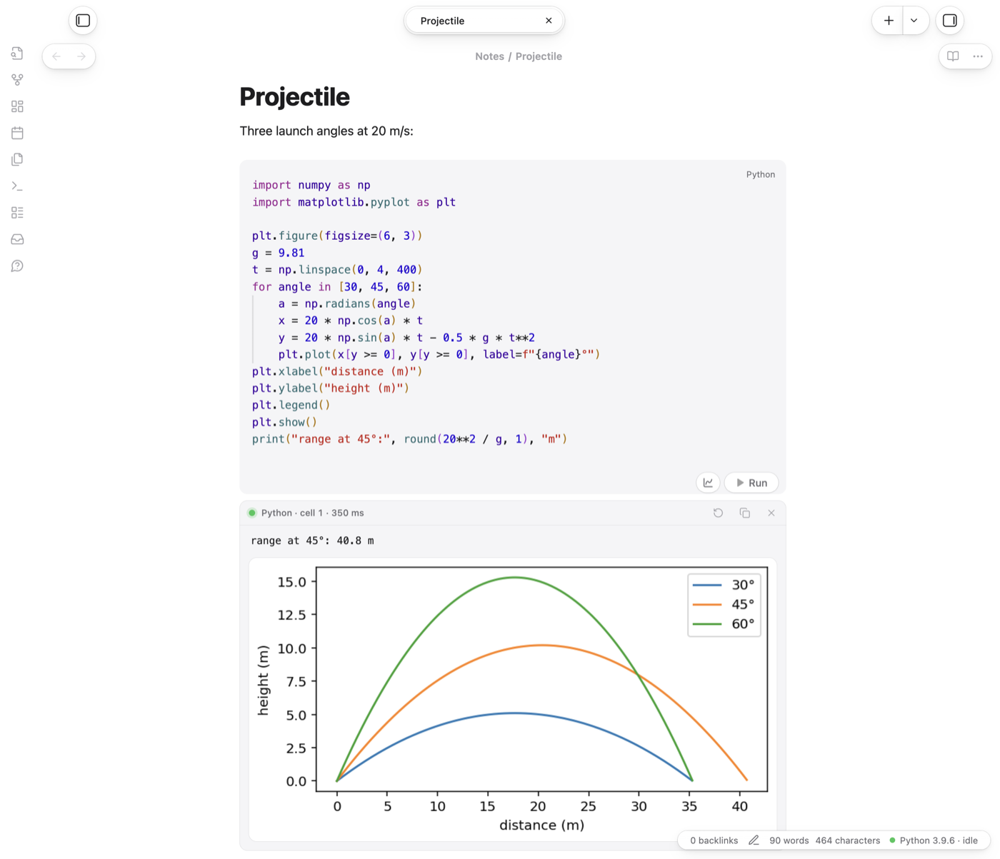

# Tahoe Run

**Run the code in your notes, like a notebook.** Python gets a live kernel with a real debugger and a variables view, MATLAB runs in a session of your own MATLAB, and C, C++, Swift, JavaScript and twenty-odd other languages run with the tools you have installed. The output, plots included, appears right under the block. Python also runs on iPhone and iPad (beta).



- Click where a line's number is for a **breakpoint**, run, and **step** through the loop while the variables update.
- `plt.show()` puts the **plot under the block**; `FuncAnimation` becomes a looping GIF.
- *No module named 'cv2'?* The output offers to **install it** into the note's Python and runs the block again.



## Highlights

- **A Python notebook in your notes.** Blocks in a note share one Python session, so variables, imports and functions carry over, and a bare expression on the last line shows its value.
- **A real debugger.** Click where a line's number is (or press ⌘\ / Ctrl+\\) for a breakpoint, run, and step over, into and out of your code from the output card.
- **A variables view**, like MATLAB's Workspace, with sheets for lists, arrays, DataFrames, dicts and MATLAB matrices, structs and tables.
- **MATLAB** with your own MATLAB and its licence: one session per note, figures under the block, and `drawnow` loops as animations.
- **Plots and animations** under the block: Matplotlib figures, `FuncAnimation` as looping GIFs, and progress bars that update in place.
- **Packages:** when a block fails with *No module named 'cv2'*, the output offers to install `opencv-python` into the note's Python, then runs the block again.
- **Jupyter:** export a note as a `.ipynb` notebook (with its outputs and plots), a `.py` script with `# %%` cells or a `.m` script with `%%` sections, and import notebooks and scripts as notes.
- **Explain this error:** a model explains a failed block and suggests a fix you can apply.

## Languages

Python, MATLAB, GNU Octave, JavaScript, TypeScript (through `npx tsx`), Swift, C, C++, Objective-C, Java, Kotlin, C#, Go, Rust, Ruby, PHP, Perl, Lua, R, Julia, Haskell, Bash, Zsh, AppleScript and SQLite. Any of them whose tools are installed works; the settings show which were found, and each language's command can be changed. The PATH comes from your login shell, so Homebrew tools are found. Compiled languages are built first.

Tahoe Run is developed and tested on macOS. It's written to work on Windows and Linux too, but that hasn't been tested yet; reports are welcome.

## Using it

- **Run:** the ▶ Run capsule on a block, or *Run code block at cursor*, *Run all code blocks in note* and *Stop all running code* from the command palette. Assign hotkeys in Settings → Hotkeys.
- **⇧Enter** runs a block and moves to the next one, or starts a new block below the last, as in Jupyter.
- **Saved output:** each run's output (and its plots, as image attachments) is written into the note in an *Output* callout under the block, so it's still there next time. Running again replaces it; clearing it moves its images to the trash. You can turn this off.
- **Errors link to their lines.** Click *line 3* or *main.cpp:3:14* in an error to jump to that line of the block.
- **Hover a name** in a Python or MATLAB block to see its value in the running session.

### Python

- **Kernel:** one live Python per note, with restart and interrupt commands. Idle kernels stop after 30 minutes (adjustable).
- **Choose Python for this note…** lists the Pythons on your computer (virtual environments near the note and in `~/.virtualenvs`, conda, pyenv, Homebrew, python.org) and can make a new virtual environment. The choice is saved as the note's `python:` property.
- **Debugger:** only blocks with breakpoints are traced, so code runs at full speed until it reaches one. Step into goes into functions defined in earlier blocks; library code is stepped over. While paused, the variables view and hover values show the paused function's variables. Keys: F6 over, F7 into, F8 out, ⌃⌘Y continue.

### MATLAB

Write ` ```matlab ` blocks and press Run. On a Mac, Tahoe Run finds the newest MATLAB in Applications; elsewhere it uses `matlab` from your PATH. The first block waits about 10 seconds while MATLAB starts; after that, blocks run in milliseconds and share their variables. At most two notes keep a session at once, since each MATLAB uses about a gigabyte. Turn off *MATLAB session per note* to run each block with `matlab -batch` instead. ` ```octave ` blocks run with GNU Octave if it's installed.

### Python on iPhone and iPad (beta)

Python blocks also run on iPhone and iPad, with [Pyodide](https://pyodide.org) (Python 3.14 built for the web), inside Obsidian and offline. Download it once in *Settings → Tahoe Run → Python on iPhone and iPad* (about 13.5 MB); it goes into the plugin's folder, so a synced vault brings it to your other devices. numpy, matplotlib and the other packages built for Pyodide download the first time a block imports them, and stay. Each note keeps its own variables, plots show under the block, and hover values and the variables view work. On a phone or tablet there's no debugger, `input()` or pip, and a running block can't be stopped until it ends.

This part is in **beta**: it has been tested in Obsidian's mobile mode on a Mac, not yet on a real iPhone or iPad. *Use it on this computer too* runs a note exactly as a phone would.

### Explain this error

When a block fails, its output gets an **Explain** button: a model reads the code and the error, explains what went wrong and suggests a fix, with **Apply fix**. Choose the model in the settings, or leave it on *Automatic*, which tries them in this order:

1. **Apple Intelligence**, on a Mac with macOS 26 or later and Apple Intelligence on: free and on-device. A small helper is built with Xcode's command line tools the first time, so those need to be installed.
2. **Ollama**: free and local, if [Ollama](https://ollama.com) is running with a model.
3. **Claude**, through Anthropic's API, if you've added an API key (stored in Obsidian's secure storage, not in the vault). Pay-as-you-go, usually well under a cent per answer.
4. **Copy prompt**: copies a ready-made prompt for any chat app.

### Complexity checker

*Check complexity of code block at cursor* times a Python function (or a whole program that reads its input) on growing inputs and reports O(1) to O(2ⁿ) with a log-log chart.

## Disclosures

- **It runs programs on your computer:** your Python, MATLAB, compilers and other language tools, with your user account's permissions, when you run a block. Only run code you trust. A Python kernel or MATLAB session keeps running for a note until it's idle for 30 minutes, you restart it or Obsidian quits.
- **Network use**, only when you ask for it:
  - *Python on iPhone and iPad:* Pyodide is downloaded from cdn.jsdelivr.net when you press Download in the settings, and its packages from the same place when a block first imports them. Each package is checked against the SHA-256 in Pyodide's package list before it's kept.
  - *Installing a missing package* runs `pip`, which downloads from PyPI, after you confirm.
  - *Explain with Claude* sends the failing block's code and output to Anthropic's API (api.anthropic.com) with your API key. Apple Intelligence runs on your Mac, and Ollama on your own computer (localhost), so with those your code doesn't leave it.
- **Files outside your vault:** runs use temporary folders in your system's temp folder. *Choose Python… → New environment* creates it in `~/.virtualenvs`. The Apple Intelligence helper is kept in `~/Library/Caches/tahoe-run`. To list your Pythons, it looks in the usual places they're installed.
- **Clipboard:** it writes to the clipboard only when you press a Copy button (an output, a sheet as Markdown or CSV, or a prompt for a chat app). It never reads the clipboard.
- **No telemetry, ads or accounts.** Claude needs your own Anthropic API key, only if you choose it.

<!-- tahoe-family -->
## The Tahoe family

Tahoe is a set of plugins and a theme that work on their own and fit together.

| | | |
| --- | --- | --- |
| **Tahoe Run** | Run the code in your notes, like a notebook: Python with a debugger and variables view, MATLAB, and ~25 other languages. | this one |
| **[Tahoe Math](https://github.com/krishnanefx/obsidian-tahoe-math)** | A calculator in your notes: type an expression ending in `=` and the answer appears. | in the community directory |
| **[Tahoe](https://github.com/krishnanefx/obsidian-tahoe-theme)** | A clean, Mac-like theme, in light and dark. | in the community directory |
| **Tahoe Code** | An IDE in your code blocks: suggestions, checking as you type, quick fixes, go to definition, formatting and AI edits. | coming soon |
| **Tahoe Glass** | Real refraction for the Tahoe theme's glass, and System Settings–style settings pages. | coming soon |
| **Tahoe Organize** | Keep a growing vault tidy: inbox triage, Smart Folders, coloured tags, link suggestions, vault health and text from images. | coming soon |
| **Tahoe Intelligence** | On-device AI for your notes: related notes, distilling permanent notes, Writing Tools and more. | coming soon |

**Better together**

- **With Tahoe Code (coming soon):** Python and MATLAB blocks get suggestions from the running session (a data frame's real columns, a struct's fields), and ⌘I on an equation writes it as a function that Tahoe Run then runs and checks.
- **With [Tahoe Math](https://github.com/krishnanefx/obsidian-tahoe-math):** quick sums stay in the prose around your code, with no block needed.
- **With [Tahoe](https://github.com/krishnanefx/obsidian-tahoe-theme):** Tahoe Run uses Obsidian's own colours and controls, so its capsules and output cards look native in Tahoe (or any theme).
<!-- /tahoe-family -->

## Credits

Third-party code included in Tahoe Run, with its licences, is listed in [THIRD_PARTY_NOTICES.md](THIRD_PARTY_NOTICES.md).

Tahoe Run is an independent project. It isn't affiliated with, or endorsed by, Apple, MathWorks, Jupyter or Anthropic.

## License

[MIT](LICENSE) © 2026 Krishnan Adaikkappan

## Building from source

```sh
npm ci
npm run build     # writes main.js
```

Releases are built by GitHub Actions: push a tag that matches the version in `manifest.json`, then publish the draft release it creates.
